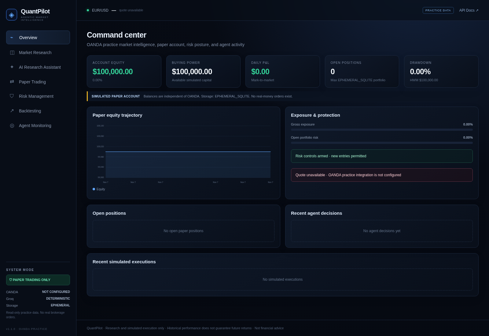
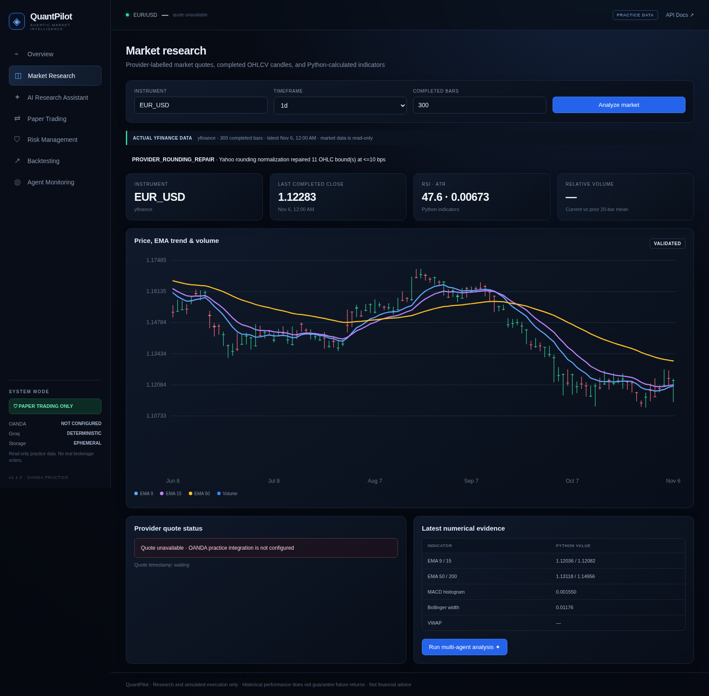
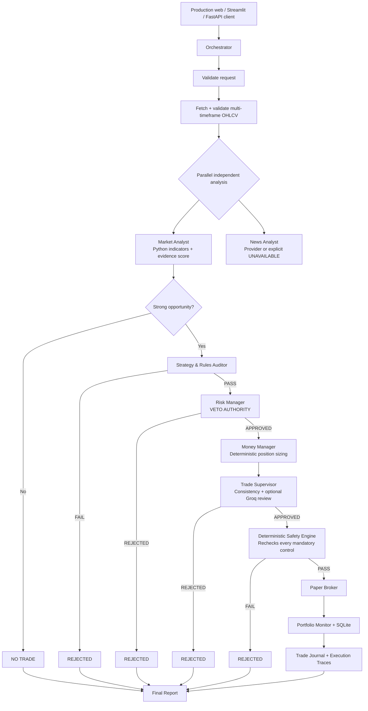

# QuantPilot

**Multi-agent quantitative trading intelligence and deterministic paper execution**

QuantPilot is a full-stack AI engineering portfolio project: a user submits a ticker, timeframe, and objective; specialized agents analyze actual or explicitly labelled synthetic OHLCV data; Python enforces strategy, risk, sizing, and execution controls; and the complete decision is persisted with agent/tool traces. Groq is an optional structured interpretation layer—not a source of numerical truth.

> **Paper trading only. Not financial advice.** There is intentionally no real-money brokerage adapter. Historical simulations do not guarantee future returns.

## Product tour

| Production web overview | Production web market research |
|---|---|
|  |  |

The dependency-free web application is served by FastAPI and uses relative API URLs. Provider provenance and nonfatal data repairs are shown explicitly. The local research capture uses Yahoo Finance; the configured Vercel project uses strict OANDA practice data. Streamlit remains available as an alternative local dashboard.

## What works end to end

- **LangGraph state machine** with typed shared state, parallel market/news analysis, bounded waits, fail-closed errors, and conditional NO_TRADE/REJECTED/APPROVED routing.
- **Seven specialized agents** with Pydantic outputs, measured latency, tool traces, explicit unavailable states, and optional Groq structured review.
- **Quantitative engine** for OHLCV validation, EMA/SMA/RSI/MACD/ATR/Bollinger/VWAP/relative volume, support/resistance, and explainable confidence.
- **Independent risk and money management** with a risk veto, cost-aware sizing, exposure/concentration checks, and persistent hard halts.
- **Deterministic safety gate** that repeats critical checks immediately before execution. Agents and LLMs cannot override it.
- **SQLite paper broker** with market/limit orders, idempotent client IDs, cancellation, stops/targets, partial closes, fees, slippage, long/short accounting, fills, and journals.
- **Event-driven backtesting** with next-bar execution, stop-first ambiguous bars, transaction costs, equity/drawdown curves, trade history, and buy-and-hold comparison.
- **Read-only OANDA v20 practice integration** for completed forex candles, real-time bid/ask/mid quotes, spread, and account metadata. Live OANDA environments and order endpoints are intentionally unavailable.
- **FastAPI + interactive OpenAPI docs**, a dependency-free seven-workspace production web app, and a seven-section Streamlit dashboard.
- **Vercel serverless entrypoint and routing**, strict provider configuration, current configurable Groq production models, and explicit ephemeral-storage reporting when PostgreSQL is absent.
- **55 offline tests** using deterministic data and mocked OANDA responses; no test needs Groq or a live market API.

## Architecture



### Trust boundaries

| Layer | Authority |
|---|---|
| Market/news providers | External evidence, timestamps, and source metadata only |
| Python agents | Indicators, confidence components, rules, risk, sizing, and consistency checks |
| Groq | Optional request extraction and supervisor narrative; Pydantic-validated; can only tighten a review |
| Deterministic safety engine | Final permission to execute; repeats approvals, risk, buying power, freshness, and duplicate checks |
| Paper broker / repository | Only components allowed to mutate orders, positions, cash, and journals |

## Agent responsibilities

| Agent | Implementation | Deterministic guarantees |
|---|---|---|
| Orchestrator | `agents/orchestrator.py`, `orchestration/workflow.py` | Input validation, data retrieval, delegation, routing, final evidence report; no veto override |
| Market Analyst | `agents/market_analyst.py` | Multi-timeframe regime, direction, ATR-based levels, evidence, conflicts, and data limitations |
| Risk Manager | `agents/risk_manager.py` | Risk/reward, daily loss, drawdown, volatility, concentration, exposure, portfolio risk, and position limits |
| Money Manager | `agents/money_manager.py` | Risk-budget quantity with stop distance, fees, slippage, buying power, allocation caps, and lot rounding |
| Strategy Auditor | `agents/rules_auditor.py` | Fresh EMA 9/15 cross, RSI, HTF alignment, volume, price geometry, session, and side permission |
| News Analyst | `agents/news_analyst.py` | Optional provider, timestamps/URLs, transparent keyword sentiment, conflicts; never invents unavailable news |
| Trade Supervisor | `agents/trade_supervisor.py` | Cross-agent consistency and missing-information review; cannot resize, execute, or relax controls |
| Portfolio Monitor | `agents/portfolio_monitor.py` | Mark-to-market equity, exposure, high-water mark, P&L, drawdown, and persistent trading halts |

### Explainable confidence

Confidence is calculated in Python, not requested from an LLM:

```text
0.45 base
+ 0.40 × min(abs(net evidence score) / scored components, 1)
+ higher-timeframe adjustment (+0.05 aligned / -0.08 conflicting)
- data penalty (0.05 when EMA-200 evidence is unavailable)
```

The result is capped to `[0, 0.95]`. Direction requires a net score of at least `+3` or `-3`; otherwise the regime is SIDEWAYS and confidence is capped below the strategy threshold. Exact ties contribute zero rather than a false bearish vote. Every component is included in the output.

### Position sizing

```text
Risk amount       = equity × min(per-trade risk budget, remaining portfolio risk budget)
Adjusted unit risk = |entry - stop| + entry × (fee rate + slippage rate)
Raw quantity      = risk amount / adjusted unit risk
Final quantity    = floor_to_lot(min(raw, buying-power cap, notional cap, exposure cap))
```

The safety engine independently recomputes risk after sizing. These are configurable simulation defaults, not universal trading recommendations.

## Project layout

```text
quantpilot/
├── app.py                      # Streamlit composition root
├── run_api.py                  # Combined web + API Uvicorn launcher
├── public/                     # Production HTML/CSS/JavaScript web application
├── api/                        # FastAPI app, Vercel entrypoint, versioned routes
├── agents/                     # Specialized agents, Groq adapter, orchestrator
├── orchestration/              # Typed state and compiled LangGraph workflow
├── tools/                      # OANDA/Yahoo/synthetic data, indicators, risk, news, backtests
├── execution/                  # Safety engine, order manager, paper broker
├── models/                     # Pydantic market/trade/portfolio/agent contracts
├── database/                   # SQLAlchemy models, sessions, repository
├── dashboard/                  # Overview, research, assistant, trading, risk, backtests, monitoring
├── config/                     # Environment settings + risk/strategy YAML
├── tests/                      # Offline deterministic Pytest suite
├── docs/screenshots/           # Actual running-application screenshots
└── .github/workflows/tests.yml # Python 3.11 CI
```

## Installation

### Prerequisites

- Python **3.11+** (tested here on Python 3.13)
- A virtual environment is recommended
- Optional Groq API key for LLM-assisted request extraction/supervisor review
- Optional OANDA **practice** credentials for read-only real-time forex data
- Network access for OANDA or Yahoo Finance; local demos may use the labelled synthetic provider

```bash
git clone <your-repository-url> quantpilot
cd quantpilot
python -m venv .venv
source .venv/bin/activate          # Windows: .venv\Scripts\activate
python -m pip install --upgrade pip
pip install -r requirements-dev.txt       # production-only: pip install -r requirements.txt
cp .env.example .env               # Windows: copy .env.example .env
```

### Environment

```dotenv
GROQ_API_KEY=
GROQ_MODEL=llama-3.3-70b-versatile
DATABASE_URL=sqlite:///./quantpilot.db
DATA_PROVIDER=auto
ALLOW_SYNTHETIC_FALLBACK=true
NEWS_PROVIDER=none
NEWS_API_KEY=
OANDA_API_KEY=
OANDA_ACCOUNT_ID=
OANDA_ENVIRONMENT=practice
```

| Variable | Behavior |
|---|---|
| `GROQ_API_KEY` | Empty means deterministic mode; no fake LLM output is produced |
| `GROQ_MODEL` | Model selected entirely through configuration |
| `DATABASE_URL` | SQLAlchemy URL; SQLite is the MVP default |
| `DATA_PROVIDER` | `oanda`, `yfinance`, `synthetic`, or `auto`; strict `oanda` never substitutes synthetic data |
| `ALLOW_SYNTHETIC_FALLBACK` | In `auto`, controls whether provider failure can use reproducible synthetic OHLCV |
| `OANDA_API_KEY` / `OANDA_ACCOUNT_ID` | Practice-account credentials for candles, quotes, and read-only account metadata; never place them in source |
| `OANDA_ENVIRONMENT` | The settings layer forces `practice`; `live` is rejected by the provider |
| `NEWS_PROVIDER` | `none` or `yfinance`; no provider returns explicit UNAVAILABLE |
| `LLM_TIMEOUT_SECONDS` | Optional; default 20 seconds |
| `LLM_MAX_RETRIES` | Optional; default 2 bounded retries |

`PAPER_ONLY=true` is displayed in `.env.example`, but the code treats paper-only as immutable rather than allowing an environment variable to enable real trading.

## Run the application

### Streamlit dashboard

```bash
streamlit run app.py
```

Open `http://localhost:8501`.

### Production web app + FastAPI

```bash
python run_api.py
# or: uvicorn api.main:app --host 0.0.0.0 --port 8000
```

- Web application: `http://localhost:8000/`
- API health: `http://localhost:8000/health`
- Swagger UI: `http://localhost:8000/docs`
- ReDoc: `http://localhost:8000/redoc`

FastAPI mounts `public/` after registering API and documentation routes. The web app needs no CDN, Node build, or external browser assets. Streamlit imports the same backend services directly and does not require this API process.

### Convenience commands

```bash
make setup       # install dependencies
make run         # Streamlit
make api         # FastAPI
make test        # complete test suite
make check       # tests + byte-code compilation
```

## Vercel deployment

The production deployment is live at **https://quantpilot-gamma.vercel.app/** (Vercel CLI [@](https://vercel.com) + `builds` in `vercel.json`: `@vercel/python` serves the FastAPI app, `@vercel/static` serves `public/`). `quantpilot-trader-737b.vercel.app` is behind Vercel SSO protection; the custom domain serves the web app anonymously. `/` serves the seven-workspace web app, `/health` reports paper mode plus the non-ephemeral Supabase PostgreSQL connection, and `/docs` serves the OpenAPI UI. Pushing to `main` does not auto-deploy (project Git integration creates deployments only through the connected pipeline); deploy explicitly.

**Autopilot (paper-only).** Two mechanisms re-run the complete agent workflow without a human click: (1) the *Autopilot* toggle on the **AI research assistant** page re-runs the full chain every 60 s while the browser tab is open; (2) Vercel Cron calls `GET /api/v1/cron/tick` on weekdays at 08:00 UTC (Hobby plan allows one run per day). `AUTOPILOT_SYMBOL` (default `EUR_USD`), `AUTOPILOT_TIMEFRAME` (default `1h`), `AUTOPILOT_OBJECTIVE`, and `AUTOPILOT_EXECUTE` (default `true`) configure it; set `CRON_SECRET` to require Vercel's `Authorization: Bearer` header. Autopilot can only place simulated paper orders through the deterministic safety gate — stale data, failed controls, or a missing fresh crossover block every order. For true continuous polling (sub-daily), point any external scheduler at `/api/v1/cron/tick`.

See **[docs/DEPLOYMENT.md](docs/DEPLOYMENT.md)** for the configured environment, exact deployment path, storage warning, and post-deployment OANDA/workflow verification checklist. No credential values are stored in the documentation.

## Example use cases

### 1. Multi-agent research without automatic execution

In **AI Research Assistant**, enter `AAPL`, select `1d`, submit an objective, and leave auto-execution off. Inspect:

1. Data provenance and timestamps.
2. Market features and confidence components.
3. Rule-by-rule numerical evidence.
4. Risk restrictions and position sizing.
5. Supervisor concerns and missing information.
6. Final safety checks and all tool traces.

```bash
curl -X POST http://localhost:8000/api/v1/research \
  -H 'Content-Type: application/json' \
  -d '{
    "ticker":"AAPL",
    "timeframe":"1d",
    "request":"Find a rule-compliant EMA crossover setup; reject on any conflict.",
    "rows":300,
    "auto_execute":false
  }'
```

An APPROVED result with `auto_execute=false` means the proposal passed validation but was intentionally not submitted. A fresh crossover is required, so many valid research runs should correctly end in REJECTED or NO_TRADE.

### 2. Approved paper execution

Enable **Execute automatically only if every check passes**. Only a complete chain of PASS/APPROVED outputs can reach the broker. Reusing the same client order ID is blocked. Open positions can be monitored or partially closed in **Paper Trading**.

### 3. Backtest the strategy

```bash
curl -X POST http://localhost:8000/api/v1/backtests \
  -H 'Content-Type: application/json' \
  -d '{
    "ticker":"AAPL",
    "timeframe":"1d",
    "rows":300,
    "config":{
      "fast_ema":9,
      "slow_ema":15,
      "risk_per_trade_pct":0.01,
      "atr_stop_multiple":1.5,
      "atr_target_multiple":3.0,
      "fee_bps":1.0,
      "slippage_bps":2.0
    }
  }'
```

Signals at close `t` execute at open `t+1`. A signal can never fill on its own bar. Protective stops win when stop and target share a candle.

### 4. Replay a candle through the paper broker

```bash
curl -X POST http://localhost:8000/api/v1/paper/candles \
  -H 'Content-Type: application/json' \
  -d '{"symbol":"AAPL","open":100,"high":102,"low":98,"close":101}'
```

This processes marketable pending limits and protective exits, then marks the position to the supplied close.

## HTTP API summary

| Method | Endpoint | Purpose |
|---|---|---|
| GET | `/health` | Paper mode, database, and optional Groq status |
| GET | `/api/v1/market/candles/{symbol}` | Completed provider candles, Python indicators, provenance, and data-quality disclosures |
| GET | `/api/v1/market/quote/{symbol}` | Current OANDA practice bid/ask/mid/spread quote |
| GET | `/api/v1/market/oanda/account` | Read-only OANDA practice account metadata |
| GET | `/api/v1/market/integrations` | OANDA, Groq model, and persistence status |
| GET | `/api/v1/paper/risk/config` | Active deterministic risk limits |
| POST | `/api/v1/research` | Run complete multi-agent workflow |
| GET | `/api/v1/research/runs` | Decision history |
| GET | `/api/v1/research/runs/{run_id}` | Complete persisted report |
| GET | `/api/v1/research/traces?run_id=...` | Agent/tool execution traces |
| GET | `/api/v1/paper/portfolio` | Mark-to-market account and risk snapshot |
| GET | `/api/v1/paper/positions` | Open positions |
| GET | `/api/v1/paper/orders` | Orders, including pending/rejected/cancelled |
| GET | `/api/v1/paper/fills` | Simulated execution history |
| GET | `/api/v1/paper/equity` | Equity/drawdown history |
| GET | `/api/v1/paper/journal` | Append-only event journal |
| POST | `/api/v1/paper/candles` | Replay OHLC through orders/protective exits |
| DELETE | `/api/v1/paper/orders/{order_id}` | Cancel a pending order |
| POST | `/api/v1/paper/positions/{symbol}/close` | Full or partial paper close |
| POST | `/api/v1/paper/reset` | Deliberately reset paper account/demo state |
| POST | `/api/v1/backtests` | Run configured historical event simulation |

Pydantic response models and generated OpenAPI schemas are available in Swagger. Broker errors intentionally surface rather than being converted into approvals.

## Configuration

### `config/risk_config.yaml`

Defaults include 1% maximum trade risk, 2% daily loss, 5% account drawdown, three concurrent positions, 1.5 minimum risk/reward, 3% portfolio risk, 25% position notional, and 100% gross exposure. Fees, slippage, lot size, volatility, and freshness limits are also configured here.

### `config/strategy_config.yaml`

Controls EMA periods, RSI thresholds, relative volume, confidence threshold, ATR stops/targets, timeframe mapping, long/short permissions, UTC sessions, and whether a fresh crossover is mandatory.

The Money Manager reads risk policy but cannot change it. The orchestrator and supervisor have no methods for changing account equity or relaxing YAML controls.

## Testing and verification

```bash
pytest -q
python -m compileall -q . -x 'quantpilot.db|docs'
```

Current result: **55 passed**, plus clean Python compilation, frontend JavaScript syntax validation, and Chromium checks of all seven web workspaces. A live Yahoo forex regression also passed with a visible bounded-rounding repair disclosure. Live OANDA verification still requires a successful deployment because credentials exist only in Vercel environment settings.

Coverage includes:

- Provider failure, empty/missing/duplicate/invalid/stale OHLCV.
- Known indicator values, RSI extremes, VWAP, relative-volume shift, and cross detection.
- Invalid stops, risk/reward, abnormal volatility, daily loss, drawdown, and capital constraints.
- Cost-aware position sizing and strategy violations with numerical evidence.
- Conflicting agent outputs and explicit failed-agent execution.
- Incomplete outputs, stale execution data, quantity tampering, and independent safety rechecks.
- Duplicate orders, limit cancellation/fills, conservative stops, long/short accounting, partial closes, and full fee reconciliation.
- Persistent loss/drawdown halts.
- Backtest trade generation, fees, chronological splitting, and next-bar/no-look-ahead behavior.
- Full APPROVED paper execution, NO_TRADE, provider failure, run persistence, and HTTP API contracts.

Tests use temporary SQLite databases and deterministic OHLCV fixtures. They never require live APIs, external credentials, or Groq availability.

## Interview demonstration script

1. **Trust boundary:** show `execution/safety_engine.py`; explain that every agent approval is necessary but insufficient.
2. **Quantitative evidence:** run Market Research and expand confidence methodology/features.
3. **Coordination:** run AI Research Assistant and inspect the parallel traces and typed outputs.
4. **Fail closed:** point to the test that injects an agent crash and verifies REJECTED plus a FAILED trace.
5. **Risk veto:** show the daily-loss/drawdown tests and persistent portfolio halt.
6. **Execution accounting:** open Paper Trading and inspect order/fill IDs, fees, slippage, and partial-close behavior.
7. **Look-ahead prevention:** show the backtest mutation test and next-bar timestamps.
8. **LLM discipline:** explain that no API key is needed for valid deterministic operation; Groq output is schema-validated and cannot calculate or resize trades.

## Known limitations

- Yahoo Finance can be delayed, rate-limited, adjusted differently, or unavailable. Data limitations are shown; this is not an exchange-grade feed.
- Staleness uses configurable bar-age limits, not a full exchange holiday/calendar engine.
- Synthetic OHLCV is for functional demonstrations only and is never represented as actual market data.
- News sentiment is a transparent keyword heuristic, not a finetuned financial language model. Event detection is limited to retrieved text.
- The MVP supports one open position per symbol, immediate full entry fills, and partial **position closes**; partial entry fills and advanced queue simulation are not modelled.
- Paper shorts use a simple 100% buying-power/margin assumption. Borrow availability, funding, dividends, corporate actions, and tax lots are not modelled.
- Limit/stop simulation uses OHLC references and configurable slippage, not tick-level bid/ask queues. Ambiguous protective bars choose the stop first.
- Backtest annualization defaults to 252 periods; set `periods_per_year` appropriately for other sampling frequencies. No walk-forward optimizer is included.
- SQLite and direct dashboard service composition target a single-user demo. Production concurrency requires a server database, migrations, authentication, and background workers.
- The Vercel deployment's `DATABASE_URL` points to the Supabase PostgreSQL pooler (transaction pooling, port 6543). Prepared statements are disabled for psycopg to stay compatible with transaction pooling. SQLite remains the local/test default only.
- Yahoo forex can round OHLC bounds independently. QuantPilot repairs only discrepancies at or below 10 bps, emits `PROVIDER_ROUNDING_REPAIR`, and keeps larger inconsistencies fatal. OANDA data is not normalized this way.
- Yahoo Finance news is configured in Vercel. A live request during validation returned Yahoo's own outage response; the News Analyst correctly returned explicit UNAVAILABLE instead of generated news. OANDA market data is unaffected.
- LLM token usage is logged when supplied by Groq. The deterministic fallback intentionally does not claim LLM reasoning.
- Streamlit streams LangGraph node-completion events during research, but does not stream token-by-token LLM output.

## Roadmap

- Alembic migrations, PostgreSQL, authentication, and multi-user account isolation.
- Exchange calendars, corporate-action-aware data, websocket marks, and richer event providers.
- Walk-forward/anchored evaluation, parameter sensitivity, benchmark costs, and Monte Carlo robustness reports.
- Tick-level fill models, bracket-order state machines, and partial entry fills.
- Additional independently testable strategies and portfolio-level optimization.
- Streaming LangGraph events and a production task queue for long-running research.
- More advanced LLM tool-use evaluations, prompt-injection defenses, and structured model-quality benchmarks.

## License

MIT — see [LICENSE](LICENSE).

---

**QuantPilot is research software. It does not provide investment advice, assured returns, or real-money execution.**
